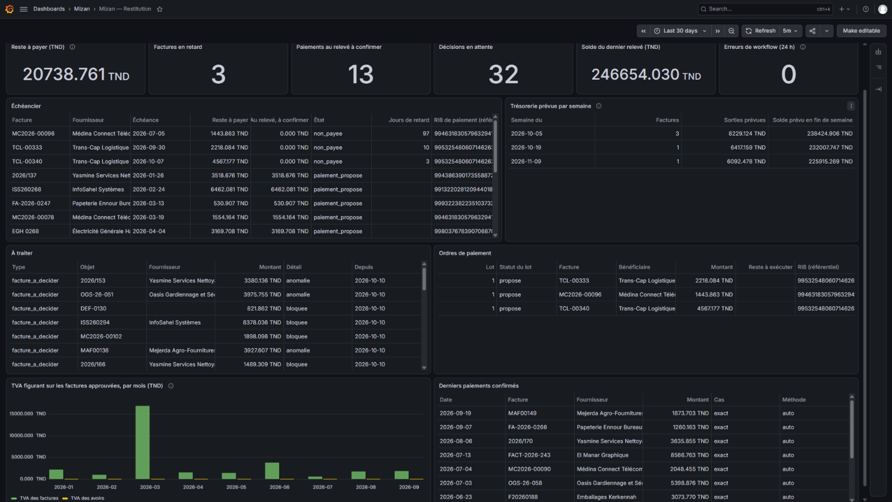
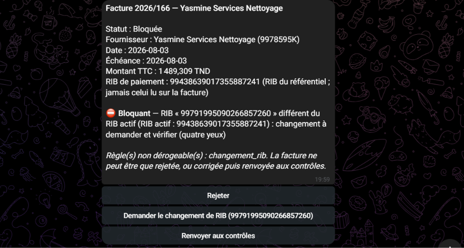
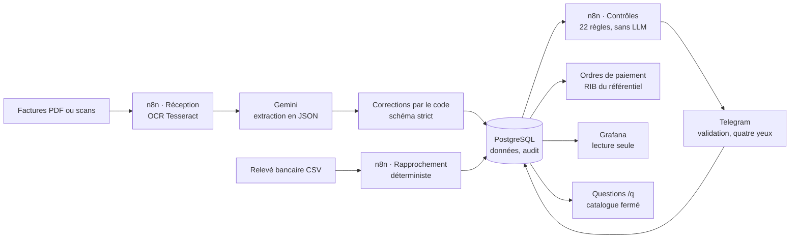
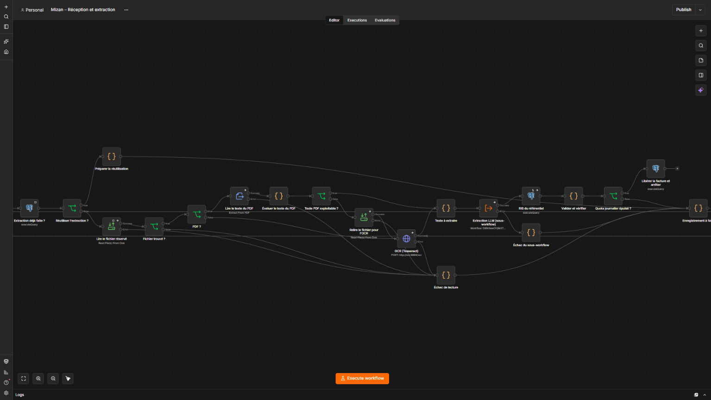

# Mizan

Contrôleur de factures fournisseurs avec rapprochement bancaire, pour une PME tunisienne.

**Auteur :** Mohamed Aljene

> **In English.** Mizan is a supplier-invoice controller built on n8n and
> PostgreSQL. It reads invoices (PDF or scans) with Tesseract and Gemini, fixes
> the model's output with deterministic code, and runs 22 rule-based checks
> without any LLM. Humans approve exceptions on Telegram, with a second person
> for every bank-detail change. It prepares payment orders (it never executes
> a payment) and reconciles the bank statement.
>
> On a held-out test set, frozen before opening, it got 271/272 header fields
> right, detected 9/9 planted errors, and followed 0/2 prompt injections.
> These results come from 18 synthetic documents (limits below). A
> [glossary](docs/fonctionnement.md#glossary-english) translates the French
> terms.

## Ce que fait Mizan

Une facture déposée est lue, puis contrôlée. Si quelque chose ne va pas, elle
est soumise à une personne habilitée. Une fois la facture approuvée, Mizan
prépare un ordre de paiement sur le RIB du référentiel, que le responsable
approuve ; **il n'exécute aucun paiement**. Le virement, fait par
l'entreprise hors de Mizan, est ensuite rapproché du relevé bancaire.

Le modèle de langage ne sert qu'à **lire** la facture, et ne décide de rien.
Tout ce qui décide est du code déterministe et testé, ou une personne qui
justifie sa décision. L'orchestration repose sur [n8n](https://n8n.io)
auto-hébergé.



*Tableau de bord Grafana (base de démonstration, données synthétiques).*



*Facture au RIB modifié : bloquée, payable seulement sur le RIB du référentiel, et sans bouton « Valider » (règle non dérogeable).*





*Détail du workflow n8n « Réception et extraction » : PDF ou OCR, sous-workflow d'extraction par le modèle, RIB du référentiel, et une branche pour chaque échec.*

**Garde-fous :**
- **Paiement :** un ordre de paiement porte toujours sur le RIB du
  **référentiel**, jamais sur celui lu sur la facture.
- **Quatre yeux :** un changement de RIB ou un nouveau fournisseur exige
  l'approbation d'une seconde personne.
- **Règles non dérogeables :** les quatre règles critiques (changement de
  RIB, identité, doublons) ne peuvent pas être contournées.
- **Décisions tracées :** chaque décision est justifiée et inscrite dans un
  journal d'audit en ajout seul. Les droits sont appliqués par la base
  elle-même : n8n ne peut ni supprimer de données ni modifier ce journal.
- **Questions en langage naturel :** le modèle choisit seulement une question
  d'un catalogue fermé. Il n'écrit jamais de SQL et ne voit jamais les
  données.

## Résultats de l'évaluation finale

Mesurés le 2026-10-10 sur un **lot de test de 18 documents jamais ouverts
avant**, en une seule exécution. Le protocole a été écrit avant l'ouverture,
avec une configuration figée. Les nombres sont bruts : **un document vaut
environ 5,6 points**.

| Mesure | Résultat |
|---|---|
| Champs d'en-tête exacts : sortie brute du modèle → après corrections par le code | 266/272 → **271/272** |
| Extractions conformes au schéma : brute → corrigée | 13/17 → **17/17** |
| Documents entièrement exacts | 14/17 |
| Consignes injectées dans une facture et suivies par le modèle | **0/2** |
| Erreurs et fraudes piégées détectées par la règle prévue (un exemple par type) | **9/9** |
| Factures sans piège avec une fausse alerte | 1/9 |
| Rapprochement : bonne facture proposée pour un paiement | 3/3 |
| Rapprochement : confirmations automatiques fausses | **0/2** |

**L'unique fausse alerte : D026, un scan.**
- **Ce qui s'est passé :** l'OCR a lu une quantité de 1 au lieu de 2. La
  facture est arrêtée, pas acceptée.
- **Sur le lot de développement** (42 documents, qui ont servi à la mise au
  point) : 2 fausses alertes, et 0 confirmation automatique fausse sur 12.

**Ces chiffres sont optimistes :**
- **18 documents**, dont 4 scans seulement ;
- **un seul exemple par type de piège** : 9/9 montre que chaque règle
  fonctionne, pas un taux de détection ;
- **3 paiements seulement** pour le rapprochement ;
- **une seule exécution :** le modèle varie d'une exécution à l'autre, et le
  statut d'un ou deux documents peut changer ;
- **des factures synthétiques**, générées avec nos propres mises en page, plus
  régulières que de vraies factures.

Une règle de contrôle a été modifiée après la répétition générale et avant
l'ouverture du lot de test ([D-085](docs/decisions.md)) : elle n'a eu aucun
effet sur ce lot.

Rapport complet, avec la comparaison avec le lot de développement :
[eval/resultats/evaluation-test-2026-10-10.md](eval/resultats/evaluation-test-2026-10-10.md).

**Tests :**
- 304 tests unitaires ;
- 428 vérifications SQL (schéma et droits) ;
- 44 tests d'intégration ;
- 594/594 cas de tests par mutation des contrôles.

## Ce que le projet a appris

- **Le code corrige mieux que le prompt.** Un prompt v2, plus précis, n'a
  rien apporté face aux corrections déterministes par le code. Il dégradait
  même les désignations et recopiait un RIB abîmé par l'OCR. Il a été écarté
  ([D-052, D-053](docs/decisions.md)).
- **Une correction automatique pouvait réaliser la fraude.** Sur un scan
  abîmé, le seul RIB valide restant dans le texte peut être celui d'une
  consigne injectée. Le RIB retrouvé par le code n'est donc rempli que
  s'il est identique au référentiel ; sinon, il est proposé et déclenche
  l'alerte de changement de RIB ([D-052, D-053](docs/decisions.md)).
- **La démonstration réelle a trouvé ce que les tests ne voyaient pas.** Un
  credential rattaché au mauvais workflow par n8n lors d'un réimport
  ([D-079](docs/decisions.md)). Un chèque rapproché de la mauvaise facture,
  sans aucun moyen de corriger, ce qui a conduit à l'annulation à quatre
  yeux ([D-075](docs/decisions.md)).

## Démarrage et démonstration sans clé d'API

Prérequis : Docker Desktop, Node.js 24 ou plus, Git.

Windows (PowerShell) :

```powershell
git clone https://github.com/aljene307/mizan.git
cd mizan
node scripts/creer-env.js        # crée .env avec des secrets aléatoires : rien à saisir
docker compose up -d
npm install
npm run reconstruire-base -- --etat demonstration   # taper « mizan » pour confirmer
```

macOS et Linux (Terminal), les mêmes commandes :

```bash
git clone https://github.com/aljene307/mizan.git
cd mizan
node scripts/creer-env.js
docker compose up -d
npm install
npm run reconstruire-base -- --etat demonstration
```

`creer-env.js` remplace chaque « change-me » de `.env.example` par un secret
aléatoire et laisse vides la clé Gemini et le jeton Telegram, inutiles pour la
démonstration. Il refuse d'écraser un `.env` existant.

La dernière commande reconstruit une base de démonstration **sans appel au
modèle ni compte Telegram**. Elle rejoue les extractions enregistrées du lot
de développement :
- 42 factures contrôlées ;
- un relevé rapproché ;
- des décisions en attente ;
- un lot d'ordres de paiement.

Ouvrir ensuite :
- **le tableau de bord Grafana** sur <http://localhost:3000> (compte
  `admin`, mot de passe `GRAFANA_ADMIN_PASSWORD` de `.env`) ;
- **les workflows n8n** sur <http://localhost:5678>, à importer depuis
  `workflows/`.

Extraction réelle, Telegram, imports et commandes :
[docs/installation.md](docs/installation.md).

## Pour aller plus loin

- [Fonctionnement détaillé](docs/fonctionnement.md) : extraction, contrôles,
  validation par Telegram, rapprochement, ordres de paiement, tableau de bord,
  questions, avec les mesures et les limites de chaque partie.
- [Démonstration en 3 minutes](docs/demonstration.md) : déroulé minuté, sur
  la base de démonstration.
- [Architecture](docs/architecture.md) : conteneurs, réseaux, rôles de la
  base.
- [Décisions](docs/decisions.md) : 86 décisions numérotées, avec leurs
  raisons ; [journal](docs/journal.md) du projet.
- [Données synthétiques](data/synthetic/README.md) : 60 factures fictives,
  vérité terrain, relevé bancaire.

## Limites et suites

**Usage :**
- **Données synthétiques uniquement.** L'offre gratuite de Gemini peut
  utiliser les contenus envoyés ([conditions](https://ai.google.dev/gemini-api/terms)).
  Les messages Telegram passent par les serveurs de Telegram. Mizan n'envoie
  rien à la plateforme El Fatoora / TTN.
- **Paramètres fiscaux illustratifs.** Plusieurs taux et montants restent à
  confirmer sur les textes officiels ([D-020](docs/decisions.md)). Ce dépôt
  ne constitue **pas un conseil fiscal**. Les noms d'entreprises et de
  personnes sont fictifs.

**Fonctionnement :**
- **Une seule instance n8n, sans queue mode.** À ce volume (quelques dizaines
  de factures), Redis et des workers ne se justifient pas. Les factures sont
  déjà réservées une à une par la base (`FOR UPDATE SKIP LOCKED`, avec reprise
  d'une réservation abandonnée) : plusieurs workers pourraient les traiter
  sans se gêner.
- **Erreurs des workflows automatiques** enregistrées (message technique masqué)
  et signalées aux responsables par un message court, au plus une fois par
  heure et par workflow ([D-086](docs/decisions.md)). Les lancements manuels
  affichent leur erreur dans l'éditeur de n8n.
- **Un seul utilisateur réel :** le second responsable (quatre yeux) est un
  compte fictif, piloté par un script.
- **Pas encore faits :** relance des factures en attente, rectification d'une
  justification ([D-067](docs/decisions.md)), comparaison avec un modèle
  local ([D-084](docs/decisions.md)), questions exposées en serveur MCP
  ([D-071](docs/decisions.md)).

## Technologies

n8n 2.41.7 · PostgreSQL 18 (migrations dbmate) · Tesseract 5 ·
Gemini `gemini-3.5-flash-lite` · Telegram (passerelle interne, seule
détentrice du jeton) · Grafana 13.2.3 · Node.js 24 · Docker Compose.

## Licence

Code sous licence [MIT](LICENSE). n8n est distribué sous sa propre licence
([Sustainable Use License](https://github.com/n8n-io/n8n/blob/master/LICENSE.md)) :
ce dépôt l'utilise par son image Docker officielle, sans le redistribuer.
