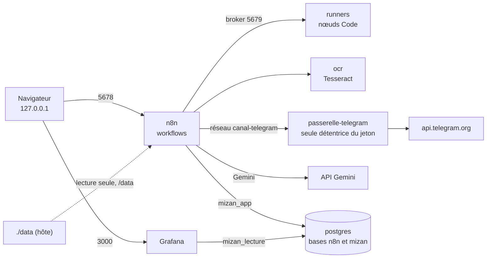

# Architecture

## Conteneurs et réseaux

| Service | Image | Rôle |
|---|---|---|
| `postgres` | `postgres:18` | Base `n8n` (interne à n8n) et base `mizan` (données métier, piste d'audit) |
| `n8n` | `n8nio/n8n` | Éditeur et moteur de workflows, sur `localhost:5678` |
| `runners` | `n8nio/runners` | Exécute le JavaScript des nœuds Code, isolé de n8n |
| `ocr` | construite depuis `ocr/` | Tesseract 5 (français), service HTTP interne, sans port publié |
| `dbmate` | `ghcr.io/amacneil/dbmate` | Migrations (profil « outils », lancé à la demande) |
| `passerelle-telegram` | construite depuis `passerelle-telegram/` | Seul détenteur du jeton du bot ; relaie 4 méthodes de l'API Telegram ; réseau dédié partagé avec n8n seul, sans port publié |
| `grafana` | `grafana/grafana:13.2.3` | Tableau de bord sur `localhost:3000`, en lecture seule (`mizan_lecture`) |

Les ports ne sont publiés que sur `127.0.0.1`. Le dossier `data/` est monté en
lecture seule dans n8n, sous `/data`.

## Rôles de la base `mizan`

| Rôle | Utilisé par | Droits |
|---|---|---|
| `mizan_app` | n8n | Lit et écrit les données métier ; ne peut ni supprimer de données ni modifier le journal d'audit ; les décisions humaines passent par des fonctions de la base qui vérifient rôle, justification et quatre yeux |
| `mizan_lecture` | Grafana, questions en langage naturel | Vues du schéma `restitution` seulement, en session en lecture seule |
| administrateur (`POSTGRES_USER`) | migrations, scripts d'administration | Propriétaire du schéma |

Les droits sont vérifiés par les tests SQL (`db/tests/`), dont des connexions
réelles avec `mizan_lecture`, et par les tests d'intégration.

## Workflows n8n

| Workflow | Déclenchement | Rôle |
|---|---|---|
| Réception et extraction | à la main | Reçoit les fichiers de `data/entrant/`, OCR, appelle le sous-workflow, enregistre l'extraction |
| Extraction LLM (Gemini) | sous-workflow | Appel du modèle, limitation du débit, nouvelle tentative sur l'erreur 429 |
| Contrôles | à la main | Exécute les 22 règles sur chaque facture extraite |
| Notifications Telegram | publié | Envoie les décisions à prendre |
| Réponses Telegram | publié | Reçoit boutons et justifications, les transmet à la base |
| Import et rapprochement du relevé | à la main | Importe un relevé CSV, rapproche les paiements |
| Ordres de paiement | à la main (chaque lundi à 8 h s'il est publié) | Propose un lot d'ordres de paiement |
| Questions (langage naturel) | publié | `/q` : choix d'une question du catalogue, réponse en lecture seule |
| test Gemini (une requête) | à la main | Vérifie la clé et le modèle |
| Erreurs | publié ; exécuté par n8n quand un autre workflow publié échoue | Enregistre l'erreur (masquée) et prévient les responsables, au plus une fois par heure et par workflow |
| Test d'erreur | publié le temps d'un test | Échoue chaque minute sans rien lire ni écrire, pour vérifier « Erreurs » |

Les workflows sont générés depuis `src/` par `scripts/construire-workflows.js`
(le code des nœuds Code est copié des modules testés) ; voir
[installation.md](installation.md) pour les importer.
