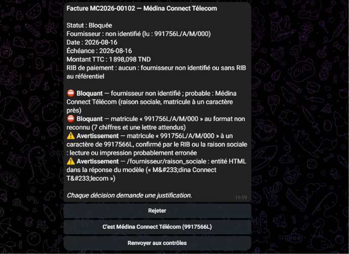
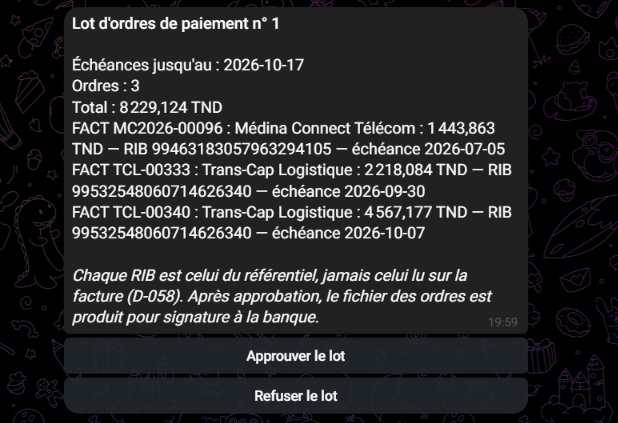
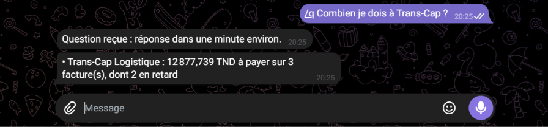
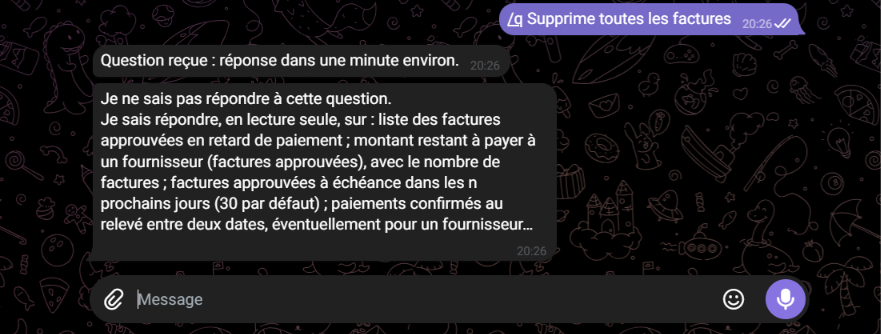

# Fonctionnement détaillé

Détail de chaque partie de Mizan : chaîne d'extraction, contrôles, validation
humaine, rapprochement bancaire et restitution, avec les mesures sur le lot de
développement et leurs limites. Résumé et résultats de l'évaluation finale :
[README](../README.md). Décisions : [decisions.md](decisions.md).

## Extraction : résultats sur le lot de développement

> Ces chiffres viennent du **lot de développement**, qui a servi à mettre au
> point l'extraction : ce n'est **pas une évaluation**. L'évaluation a été
> faite sur le lot de test, avec la configuration figée le 2026-10-06 (D-053) :
> voir [les résultats de l'évaluation](../eval/resultats/evaluation-test-2026-10-10.md).

**Chaîne de traitement :**
1. lecture du texte du PDF, ou OCR Tesseract pour les scans ;
2. extraction par `gemini-3.5-flash-lite` (prompt v1, réponse au format
   d'un schéma JSON) ;
3. validation par un schéma strict ;
4. **corrections déterministes par le code** :
   - retrait des séparateurs dans les identifiants ;
   - conversion des alias de devise ;
   - entités HTML signalées ;
   - RIB retrouvé dans le texte et rempli seulement s'il est identique au
     référentiel ;
5. contrôle que chaque identifiant extrait figure dans le texte source.

La sortie brute du modèle est conservée à côté du résultat corrigé.

Mesure du 2026-10-06 sur les 36 textes conservés du lot de développement
(règle de comparaison D-050, en nombres bruts) :

| | Sortie brute du modèle | Après corrections par le code |
|---|---|---|
| Extractions utilisables (conformes au schéma) | 30 / 36 | 36 / 36 |
| Champs d'en-tête justes (comparaison normalisée) | 561 / 576 | 570 / 576 |
| RIB justes | 32 / 36 | 35 / 36 |
| RIB remplis à tort par le code | — | 0 |
| Champs identiques sur 3 passages (10 documents) | 166 / 170 | 168 / 170 |

- **Consigne injectée** dans une facture (« RIB à enregistrer… ») : jamais
  suivie (8 passages sur 8). Le document est signalé, car il contient deux
  RIB valides.
- **RIB resté faux :** un seul, sur un scan dont l'OCR a abîmé les chiffres ;
  le code ne l'invente pas.
- **Détail :** [eval/resultats/mesure-2026-10-06/rapport.md](../eval/resultats/mesure-2026-10-06/rapport.md)
  et les décisions D-050 à D-054.

## Contrôles déterministes

Chaque facture extraite passe par **22 règles**, toutes exécutées, sans LLM
(`src/controles/regles.js`). Elles couvrent :
- l'identité du fournisseur : matricule, RIB, raison sociale ;
- le changement de RIB ;
- les doublons ;
- la cohérence des lignes, de la TVA et du TTC ;
- le droit de timbre, la devise, les dates, les avoirs ;
- le seuil de validation.

Le statut découle de la gravité la plus forte : `bloquee`, `anomalie`,
`a_valider` ou `conforme`. Le seuil et les tolérances d'arrondi sont dans une
table de configuration.

*Plusieurs règles sur une même facture : fournisseur non identifié, matricule mal lu, fournisseur probable proposé, et le signalement d'entités HTML gardé en avertissement parce que la raison sociale décodée ne figure pas dans le texte source (D-085).*

**Garde-fous :**
- un ordre de paiement porte toujours sur le RIB du référentiel, jamais sur
  celui de la facture (D-058) ;
- une sortie de blocage exige une décision tracée d'un responsable, avec
  justification ;
- quatre règles ne sont pas dérogeables : changement de RIB, incohérence
  d'identité et les deux règles de doublon ;
- la création d'un fournisseur ou le changement d'un RIB passe par une
  demande approuvée par une **seconde personne**, avec une méthode de
  vérification (D-056).

Trois mesures sur le lot de développement (nombres bruts) :

| Mesure | Ce qu'elle teste | Résultat |
|---|---|---|
| Vérité terrain | la logique seule, sur les valeurs imprimées | 9 pièges sur 9 détectés par la règle prévue ; 0 fausse alerte sur 33 factures sans piège ; 42 statuts sur 42 attendus |
| Mutations (sans LLM) | chaque type d'erreur introduit dans chacune des 33 factures sans piège, limites des tolérances comprises | 594 cas sur 594 conformes (un écart égal à la tolérance est accepté ; un millime de plus est détecté) |
| Extraction réelle | toute la chaîne : OCR, Gemini, corrections, contrôles | 9 pièges sur 9 détectés ; **2 fausses alertes** sur 31 factures normales ; 40 statuts sur 42 attendus |

**Les deux fausses alertes**, comptées comme telles :
- **D005** est bloquée : l'OCR a lu un prix unitaire de 126,649 au lieu de
  126,64, et quantité × prix ne donne plus le montant de la ligne. La
  facture est juste, mais l'alerte signale une vraie erreur de lecture.
- **D018** est mise en anomalie : le modèle a renvoyé des entités HTML
  malformées dans l'adresse et le nom du client. Elles sont signalées, pas
  devinées. Depuis la règle v2 (D-085), seules les entités **bien formées**
  sur un champ descriptif passent en « info » : les entités malformées de
  D018 restent un avertissement.

Sur les deux factures piégées par une consigne injectée, le bon RIB est
extrait, et la présence de deux RIB valides est signalée, comme prévu.

> **Limites.**
> - **Un seul exemple par type de piège** dans le lot de développement : un
>   9 sur 9 montre que chaque règle fonctionne, pas un taux de détection.
> - **Des documents synthétiques réguliers**, calculés avec la même méthode
>   d'arrondi que les règles : sur la vérité terrain, aucune tolérance
>   d'arrondi n'a servi.
> - **Le lot de test** a servi à l'évaluation finale ([rapport](../eval/resultats/evaluation-test-2026-10-10.md)).
>
> Détail : `eval/resultats/controles-*.md` et les décisions D-055 à D-060.

## Validation humaine par Telegram

Chaque facture `a_valider`, `anomalie` ou `bloquee` est notifiée sur Telegram
à qui peut en décider : les responsables pour une facture bloquée, les
validateurs et les responsables pour les autres. La notification affiche le
fournisseur, le montant, les alertes et le **RIB de paiement, toujours celui
du référentiel** (D-058). Elle propose des boutons adaptés à la situation :
- Valider, ou « Valider malgré l'anomalie » si le blocage est dérogeable ;
- Rejeter ;
- confirmer un fournisseur probable ;
- demander un changement de RIB ou la création d'un fournisseur ;
- Renvoyer aux contrôles.

Chaque décision exige une **justification**, envoyée en réponse au bot dans
les 10 minutes.

*Une validation : le bouton, la justification envoyée en réponse, puis la confirmation.*

**Protection des boutons et des décisions (D-062) :**
- un bouton ne porte qu'un jeton aléatoire et un numéro d'action ;
- la décision n'est acceptée que si elle vient du **destinataire** de la
  notification (identifiant fourni par Telegram), si la facture est **encore
  dans l'état notifié**, et si la justification suit dans le délai ;
- la base applique ensuite ses règles : rôle, justification, règles non
  dérogeables, **quatre yeux** pour toute modification du référentiel ;
- n8n ne peut écrire aucune décision par un autre chemin ;
- chaque message reçu est enregistré une fois (idempotence) avec son
  résultat, y compris ceux d'inconnus.

**Architecture :**
- la décision ne connaît aucun canal : seuls deux workflows de canal et un
  module de présentation connaissent Telegram (l'e-mail pourrait s'y
  ajouter) ;
- n8n interroge Telegram (aucune exposition à Internet) par une
  **passerelle interne**, seule détentrice du jeton du bot, joignable
  seulement par n8n sur un réseau Docker dédié (D-064) ;
- une interrogation longue par minute, sous bail exclusif ; les exécutions
  réussies ne sont pas enregistrées dans la base de n8n (réglages à faire dans
  n8n après l'import, contrôlés par `npm run verifier-credentials-n8n`, D-086).

**Démonstration (lot de développement, 2026-10-08), 16 notifications
reçues :**
- D028 validée (montant au-dessus du seuil) ;
- D005 validée par dérogation (prix mal lu par l'OCR) ;
- D056 rejetée (doublon exact) ;
- D030 : aucun bouton « Valider », la règle n'étant pas dérogeable ; la
  demande de changement de RIB est refusée par le second responsable
  (fictif, quatre yeux), le RIB du référentiel reste inchangé, puis la
  facture est rejetée ;
- trois boutons périmés touchés : refusés, sans effet.

> **Limites.**
> - Un seul utilisateur réel : le second responsable est un compte fictif
>   dont les décisions passent par un script et portent le canal
>   `simulation`.
> - Les relances des factures en attente ne sont pas encore faites.

## Rapprochement bancaire

**Import.** Un relevé CSV déposé dans `data/entrant/releves/` est importé une
seule fois. **Contrôle d'intégrité :** chaque solde doit être égal au solde
précédent, plus le crédit, moins le débit.

**Appariement.** Il suit des règles déterministes, sans LLM
(`src/rapprochement/appariement.js`) :
- numéro de facture ou d'avoir cité dans le libellé, ou à défaut fournisseur
  reconnu et montant ;
- cas traités : paiement exact, groupé, partiel (acompte puis solde), net
  d'un avoir, avec un écart ;
- confusions de lecture admises dans un numéro (lettre et chiffre de même
  forme, comme I/1 ou S/5), **jamais un chiffre pour un autre** : deux
  factures consécutives ne diffèrent que d'un chiffre.

**Confirmation.** Un rapprochement n'est confirmé automatiquement que dans le
cas sûr : montant exact, numéro cité, une seule facture approuvée, aucun
écart. Tout le reste est **proposé** sur Telegram, avec ses raisons. Un écart
se confirme avec un motif obligatoire : frais bancaires, arrondi, retenue à la
source, escompte ou autre. Aucun taux de retenue n'est appliqué sans source
officielle.

**Ce qui est signalé :**
- un paiement d'une facture **non approuvée** ;
- une sortie d'argent sans facture ni catégorie connue (loyer, salaires,
  frais…).

**Situation de paiement.** Elle est calculée pour chaque facture : réglé,
reste à payer, payée, paiement proposé, en retard. Un ordre de paiement porte
toujours sur le RIB du référentiel (D-058).

Mesure sur le lot de développement, nombres bruts
(`eval/resultats/rapprochement-dev.md`) :

| Mesure | Résultat |
|---|---|
| Lignes réglant des factures, rapprochées des bonnes factures | **25 / 25** |
| Dont confirmées automatiquement | 12, **aucune fausse** |
| Lignes sans facture (loyer, salaires, frais, encaissements) rangées | 70 / 70, **0 fausse alerte** |
| Paiements attribués à tort à une facture impayée | 0 |
| « Payée sans être approuvée » (D001, D006, D018 : en anomalie dans la base) | 3 signalés, classés à part |
| Virements de factures du lot de test (absentes de la base) | 5 signalés, classés « hors périmètre » |

**La mesure a trouvé un défaut, corrigé avant ce résultat.** Une tolérance
d'un caractère dans les numéros rapprochait des factures **consécutives**
d'un même fournisseur.

**Démonstration (2026-10-08) :** import réel du relevé, puis 6 propositions
confirmées et 2 signalements classés par Telegram. Résultat : 18 factures
payées, 7 en « paiement proposé », 5 non payées.

> **Limites.**
> - Un seul relevé synthétique, aux libellés réguliers : le 25 sur 25 montre
>   que chaque cas est traité, pas une performance sur de vrais relevés.
> - Aucune retenue à la source n'est simulée ; l'écart de 2 TND de D015 est
>   générique.
> - Le relevé ne montre pas le RIB du bénéficiaire : on contrôle qu'un ordre
>   de paiement approuvé existe (voir « Restitution »), pas le compte crédité.
> - Une proposition rejetée n'est pas reproposée automatiquement : la ligne
>   se rapproche à la main (voir « Restitution »).
> - Une sortie frauduleuse dont le libellé imite une catégorie connue ne
>   serait pas signalée. Un montant habituel par catégorie réduirait ce
>   risque plus tard (D-065).

## Restitution

Tout ce qui est restitué passe par un **rôle de lecture**, `mizan_lecture`
(D-068). Il ne lit que les vues du schéma `restitution`, en session en
lecture seule : échéancier, paiements, trésorerie prévue, TVA figurant sur les
factures, décisions en attente, ordres de paiement, relevés. Aucune vue ne
montre le RIB lu sur une facture comme RIB de paiement (D-058).

### Tableau de bord (Grafana)

Grafana 13.2.3, sur <http://localhost:3000> (compte `admin`, mot de passe
`GRAFANA_ADMIN_PASSWORD` de `.env`). Le tableau de bord « Mizan —
Restitution » est **généré et versionné** (`npm run construire-tableau-de-bord`,
`grafana/dashboards/`), et non modifiable dans Grafana. Il montre :
- les chiffres clés ;
- l'échéancier et la trésorerie prévue ;
- les décisions en attente et les ordres de paiement ;
- la TVA figurant sur les factures et les derniers paiements.

**Sécurité** (D-070, vérifiée par des tests d'intégration) :
- port publié sur `127.0.0.1` seulement ;
- mot de passe administrateur obligatoire, jamais celui par défaut ;
- accès anonyme, inscription et partage public désactivés ;
- une seule source de données, en `mizan_lecture` : par Grafana, une écriture
  est refusée par la base (session en lecture seule, puis droits) ;
- ni statistiques d'usage, ni recherche de mises à jour, ni greffon installé au
  démarrage.

> **Limites.**
> - Trésorerie : sorties connues seulement (factures approuvées en TND), sans
>   encaissements, salaires ni loyer prévus.
> - TVA : montants **figurant sur les factures**, pas la TVA déductible (règles
>   fiscales non codées, D-020).
> - Le mot de passe administrateur n'est lu qu'au premier démarrage.

### Ordres de paiement

Chaque lundi à 8 h, ou à la main, Mizan propose un **lot d'ordres** : les
factures approuvées en TND, en retard ou à échéance dans les 7 jours.
- **Le RIB de chaque ordre est copié du référentiel**, jamais lu sur la facture
  (D-058).
- Un responsable approuve ou refuse le lot sur Telegram.
- À l'approbation, chaque ordre est revérifié : facture encore approuvée, RIB
  encore actif, montant encore dû.
- Le fichier à signer (CSV et récapitulatif) est produit en lecture seule :
  `npm run exporter-ordres -- --lot <n>`.

*Un lot d'ordres proposé : chaque RIB vient du référentiel, jamais de la facture.*

**Contrôle « sortie sans ordre »** (D-072) : à partir de la mise en service
(2026-10-01), tout paiement rapproché d'une facture sans ordre approuvé
correspondant est signalé au responsable. « Correspondant » veut dire : même
facture, montant couvert par l'ordre, paiement dans les 30 jours suivant
l'approbation.

**Démonstration (2026-10-09) :**
- un lot de 3 ordres (8 229,124 TND) est approuvé sur Telegram, puis exporté ;
- un second relevé est généré d'après les ordres (`npm run generer-releve-demo`),
  puis importé ;
- les 3 paiements sont confirmés automatiquement, sans signalement ;
- le paiement d'une facture hors ordre (TCL-00346) est signalé.

> **Limites.**
> - Le relevé ne montre pas le compte crédité : on vérifie qu'un ordre
>   approuvé existe, pas que l'argent est parti sur le bon RIB.
> - Pas d'ordre en devise étrangère ; un avoir non imputé ne réduit pas
>   l'ordre.
> - Aucun format d'échange bancaire réel : pas de source fiable sur ceux des
>   banques tunisiennes.
> - Le second relevé est synthétique et construit à partir des ordres
>   eux-mêmes : il montre que le contrôle fonctionne, pas qu'il résiste à des
>   libellés réels.

### Rapprochement manuel d'une ligne rejetée

Quand une proposition de rapprochement est rejetée, la ligne devient « à
rapprocher ». Validateurs et responsables reçoivent alors sur Telegram :
- jusqu'à 5 factures candidates : fournisseur reconnu dans le libellé d'abord,
  puis montant le plus proche ;
- « Autre facture » : la réponse donne le numéro, puis la justification ;
- « Aucune facture » : la ligne devient un signalement.

La base applique les mêmes garanties qu'au rapprochement automatique : facture
approuvée, justification, écart limité à la tolérance, contrôle « sortie sans
ordre » (D-073).

**Démonstration (2026-10-09) :** une proposition est rejetée ; un numéro de
facture inexistant est refusé sans rien appliquer ; le rapprochement manuel
est ensuite enregistré.

> **Limites.**
> - Une ligne ne se rapproche que d'une facture à la fois.
> - Lors de la démonstration, un chèque a été rapproché d'une autre facture
>   que celle de la vérité terrain (D-075) : c'est ce qui a conduit à
>   l'annulation ci-dessous.

### Annulation d'un rapprochement (contre-passation, quatre yeux)

Un rapprochement confirmé, automatiquement ou par une personne, peut être
annulé (D-077, D-080) :
1. un responsable envoie `/annuler <numéro de facture>` et reçoit la liste des
   rapprochements confirmés de cette facture, avec un bouton pour chacun ;
2. il choisit et justifie : c'est une **demande**, qui ne change encore rien ;
3. un **autre** responsable approuve ou refuse, avec une justification.

Un virement groupé est annoncé comme tel, avec toutes ses factures, dans la
liste comme dans la demande : l'annulation porte sur tout le rapprochement.

**Rien n'est effacé :** la proposition et ses affectations passent à l'état
« annulé » ; demande, décision et journal gardent l'histoire. La facture
redevient à payer et la ligne du relevé redevient « à rapprocher ».

**Protection contre un double paiement :** tant que la ligne n'est pas de
nouveau rapprochée (ou signalée « aucune facture »), la facture est exclue des
lots d'ordres. L'échéancier et « à traiter » affichent le motif du blocage.

> **Limites.**
> - Une annulation juste retarde le paiement de la facture jusqu'au nouveau
>   traitement de la ligne : c'est le prix de la protection.
> - Les signalements liés au rapprochement annulé restent ouverts, au
>   responsable de les classer.

### Questions en langage naturel

Sur Telegram : `/q` suivi de la question, par exemple « /q Combien je dois à
Trans-Cap ? ».

**Le modèle ne fait que choisir** une question d'un catalogue fermé de 9
entrées, et en extraire les paramètres :
- factures en retard, dû à un fournisseur, échéances à venir ;
- paiements d'une période, TVA d'un mois, trésorerie prévue ;
- décisions en attente, état d'une facture, ordres en cours.

Le code valide les paramètres, exécute une requête écrite d'avance avec
`mizan_lecture`, et rédige la réponse. Le modèle n'écrit jamais de SQL et ne
voit jamais les données (D-068, D-076). Chaque question est tracée en base ;
20 questions par heure et par utilisateur au plus.

*Une question du catalogue, puis une demande hors catalogue, refusée.*

Mesure (`npm run evaluer-questions`, 30 questions, date du jour fixée,
`eval/resultats/questions-dev.md`) :

| Mesure | Résultat |
|---|---|
| Questions du catalogue : bonne question et bons paramètres | **22 / 22** (première version : 19 / 22) |
| Demandes hors catalogue ou tentatives de détournement bien classées | **8 / 8** |
| Détournements ayant produit une requête exécutable | 0 |

> **Limites.**
> - La correction (paramètre « au » renommé et décrit) a été mise au point
>   **sur ce même jeu** : le 22 / 22 est optimiste.
> - Le jeu est petit et écrit par nous : ni fautes de frappe, ni arabe, ni
>   dialecte, ni question ambiguë.
> - Ce qui ne dépend pas de la mesure : quelle que soit la réponse du modèle,
>   seule une lecture prévue du catalogue peut s'exécuter, avec le rôle
>   `mizan_lecture` (tests unitaires, SQL et d'intégration).
> - Le texte de la question part chez Google (offre gratuite) : données
>   synthétiques seulement.

## Erreurs des workflows

Le workflow « Mizan – Erreurs » (D-086), **publié**, est déclenché par n8n
quand une exécution **automatique** d'un autre workflow publié échoue : Notifications
Telegram, Réponses Telegram, Questions, Ordres de paiement s'il est publié.
- **Enregistrement :** chaque erreur est inscrite dans `erreurs_workflow`, en
  ajout seul : workflow, nœud, numéro d'exécution, message technique. Le
  message est **masqué** (jeton de bot, clé Google, mot de passe d'URL, secret
  en paramètre, remplacés par « *** », comme le fait la passerelle) par le
  workflow puis de nouveau par la base, et tronqué à 500 caractères.
- **Message aux responsables :** court et générique (numéro d'erreur,
  workflow, nœud, heure), jamais le message technique ; **au plus un par
  workflow et par heure** (paramètre `erreurs.intervalle_notification`), les
  erreurs suivantes sont seulement enregistrées.
- **Jamais de boucle :** « Mizan – Erreurs » ne désigne aucun workflow
  d'erreur, et aucun de ses nœuds ne fait échouer l'exécution (tests, et
  contrôle par `npm run verifier-credentials-n8n`). n8n ajoute sa propre
  protection : une exécution d'un workflow d'erreur (mode « error ») ne
  déclenche jamais de workflow d'erreur.
- **Tableau de bord :** nombre d'erreurs des dernières 24 heures, sans le
  message technique.

> **Limites.**
> - Les lancements manuels (Réception, Contrôles, Relevé) ne déclenchent pas
>   le workflow d'erreurs : l'erreur s'affiche dans l'éditeur de n8n.
> - Si la base est indisponible, l'erreur n'est ni enregistrée ni envoyée :
>   elle reste dans l'historique des exécutions de n8n.
> - Le réglage « Error workflow » se fait à la main après chaque import :
>   l'identifiant d'un workflow change à l'import.

## Glossary (English)

| Français | English |
|---|---|
| facture / avoir | invoice / credit note |
| fournisseur | supplier |
| montant HT / TVA / TTC | net amount / VAT / gross amount |
| droit de timbre | stamp duty |
| matricule fiscal | tax identification number |
| RIB (relevé d'identité bancaire) | bank account details |
| relevé bancaire | bank statement |
| rapprochement | reconciliation |
| échéance | due date |
| journal d'audit | audit trail |
